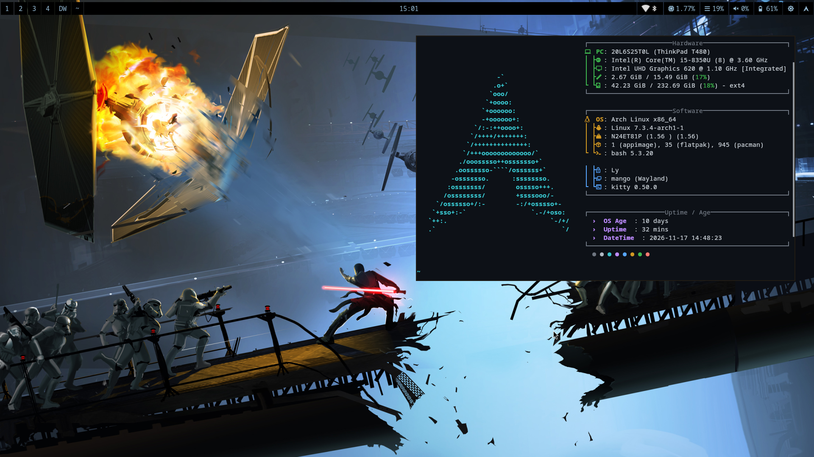

# MyMangoWC
These files are all the dotfiles i use with Mangowc, fell free to use which one you want..

# Software i use

**Top bar** = *mangobar*
**Application launcher** = *rofi*
**notifications**= *swaync*
**wallpaper**= *swaybg*
**Terminal**= *kitty*
**screenshot** = *xfce4-screenshooter*
